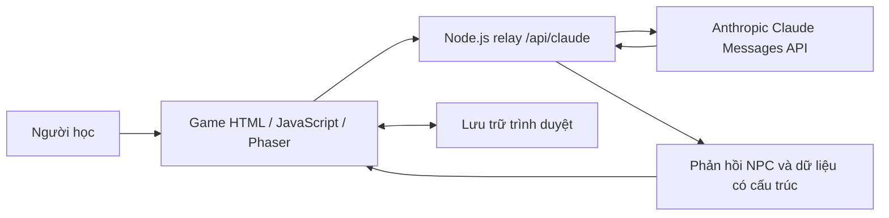

# LifeQuest AI

### Meaning Guardian · Học tiếng Anh qua thế giới nhập vai tương tác

   

> **Khám phá thế giới. Trò chuyện bằng tiếng Anh. Sửa lỗi mà không làm mất ý định của người học.**

LifeQuest AI là trò chơi nhập vai giáo dục trên trình duyệt, kết hợp đồ họa pixel art, nhân vật tương tác (NPC), nhiệm vụ theo bối cảnh và trí tuệ nhân tạo. Thay vì chỉ học từ vựng hoặc làm bài tập rời rạc, người chơi sử dụng tiếng Anh để giao tiếp, khám phá, giải quyết vấn đề và tiến triển trong câu chuyện.

*English summary: LifeQuest AI is a browser-based educational pixel-art RPG that combines contextual English conversations, quests, voice practice and meaning-preserving feedback powered by Claude.*

## 1. Mục tiêu dự án

- Tạo môi trường thực hành tiếng Anh có bối cảnh, đặc biệt phù hợp với người học ở lứa tuổi học sinh.
- Khuyến khích chủ động giao tiếp, đặt câu hỏi, giải thích ý tưởng và tự sửa lỗi.
- Điều chỉnh độ khó hội thoại theo các lựa chọn CEFR từ A1 đến C1; đây là mức luyện tập, không phải chứng nhận năng lực.
- Giữ nguyên ý nghĩa và sắc thái của người học khi đưa ra đề xuất sửa câu.

## 2. Trải nghiệm chính

| Tính năng | Mô tả |
| --- | --- |
| Hội thoại NPC | Giao tiếp bằng câu tiếng Anh tự nhập, có ngữ cảnh nhân vật, địa điểm và nhiệm vụ. |
| Nhân vật và thế giới | Chân dung pixel art, biểu cảm, quan hệ, các khu vực khám phá và nội thất công trình. |
| Meaning Guardian | Sửa tối thiểu, gợi ý cách diễn đạt tự nhiên, giải thích lỗi và kiểm tra ý nghĩa. |
| Giọng nói | Nhập bằng micro và nghe phát âm thông qua khả năng nhận dạng, tổng hợp giọng nói của trình duyệt. |
| Gợi ý hội thoại | Đề xuất câu phù hợp với tình huống khi người học cần hỗ trợ. |
| AI Coach & tra từ | Hỗ trợ học tập, giải thích từ vựng và công cụ luyện tập. |
| Nhiệm vụ | Thực hành tiếng Anh để hoàn thành các yêu cầu gắn với thế giới game. |
| Nhật ký & tiến trình | Ghi lại hoạt động học tập, lưu dữ liệu trong trình duyệt, hỗ trợ xuất và nhập bản lưu. |

## 3. Meaning Guardian — điểm nhấn của V107

Meaning Guardian được thiết kế để giải quyết một hạn chế thường gặp của công cụ sửa ngữ pháp: câu sau khi sửa có thể đúng ngữ pháp nhưng không còn đúng ý người viết.

Quy trình dự kiến trong mỗi lượt học:

1. Người học gửi câu tiếng Anh cho NPC.
2. Hệ thống phân tích lỗi, ý định và ngữ cảnh; ưu tiên sửa ít nhất có thể.
3. Khi câu có nhiều cách hiểu dẫn tới các cách sửa khác nhau, hệ thống có thể yêu cầu làm rõ thay vì tự đoán.
4. Câu sửa được đối chiếu bằng các quy tắc bảo toàn ý nghĩa và bước kiểm tra AI khi phù hợp.
5. Giao diện hiển thị lời đáp NPC trước bảng phản hồi ngữ pháp, để duy trì mạch hội thoại.
6. Người học có thể xem câu sửa tối thiểu, bảng kiểm ý nghĩa, tự sửa, nghe phát âm, sao chép, lưu vào sổ, luyện lỗi tương tự hoặc báo AI hiểu sai ý.

Các yếu tố cần bảo toàn gồm thời gian, hành động, vai trò của người tham gia, phủ định, mức độ chắc chắn, cảm xúc, số lượng, quyền sở hữu, trích dẫn và sắc thái lịch sự. Khi chưa đủ bằng chứng, kết quả có thể ở trạng thái chưa xác minh; không xem mọi đề xuất của AI là đáp án chắc chắn.

**Ví dụ minh họa** (không phải kết quả kiểm thử trực tuyến):

| Câu gốc | Sửa tối thiểu | Điều cần giữ nguyên |
| --- | --- | --- |
| I like English but I doesn't like exams. | I like English but I don't like exams. | Thích tiếng Anh nhưng không thích thi. |
| She didn't went to school yesterday. | She didn't go to school yesterday. | Phủ định và thời điểm hôm qua. |
| I don't think he is wrong. | Không cần sửa. | Phạm vi phủ định và mức độ khẳng định. |

## 4. Các vùng chơi và nội dung học tập

| Vùng | Bối cảnh thực hành |
| --- | --- |
| English Town | Giao tiếp đời thường, yêu cầu lịch sự, bưu điện, quán cà phê và thư viện. |
| Minerals Town | Miêu tả, quan sát, đặt câu hỏi và ghi chép. |
| 70 Years Ago | Kể lại sự kiện, quá khứ tiếp diễn, sắp xếp trình tự câu chuyện. |
| Art District | Giới thiệu tác phẩm, xin góp ý, giải thích thay đổi trong sáng tạo nghệ thuật. |
| Tech-Co | Giao tiếp công việc B1, sắp xếp cuộc họp, trình bày vấn đề và đề xuất giải pháp. |
| Old Oriaris | Kinh đô cũ, đối chiếu tư liệu, quá khứ tiếp diễn với while và when (B1–B2). |
| Wish Valley | Thảo luận về cộng đồng, thiên nhiên, lời ước và lời khuyên (B2). |
| Vocalt · Greedy Land | Hỏi giá, thương lượng, giải thích quan điểm và đánh giá một đề nghị. |

English Town là điểm khởi đầu. Forgotten Valley đã được loại khỏi các vùng có thể chơi trong nhánh này; một số dữ liệu tương thích vẫn được giữ trong mã nguồn để hỗ trợ bản lưu cũ. Wish Valley là vùng riêng biệt và không bị loại bỏ.

## 5. Hướng dẫn điều khiển

| Phím | Chức năng |
| --- | --- |
| WASD / phím mũi tên | Di chuyển |
| E | Tương tác với NPC hoặc đối tượng gần người chơi |
| W / ↑ tại cửa | Vào công trình |
| G | Mở menu |
| Q | Nhiệm vụ |
| H | Công cụ tra từ |
| K | Cài đặt AI |
| Enter | Gửi tin nhắn trong hội thoại |
| Alt + M | Micro trong hội thoại |
| Esc | Đóng hội thoại |
| ?word | Tra từ trong hội thoại |

Có thể bật/tắt Teacher, Voice và hiệu ứng chuyển động chân dung trong giao diện hội thoại.

## 6. Kiến trúc và phiên bản hiện tại

**Nhánh triển khai:** `deploy/lifequest-v107-claude` · **Backend:** `V107-Claude.3-DialogueGuard`



- Frontend: HTML, CSS, JavaScript, Phaser và tài nguyên pixel art nhúng.
- Backend: Node.js, sử dụng các module tích hợp sẵn; khóa API được đọc từ biến môi trường phía máy chủ.
- AI: Claude, mặc định `claude-haiku-4-5`; dùng Structured Outputs cho các yêu cầu có cấu trúc phù hợp.
- Dialogue Guard: tách nội dung lời thoại khỏi các trường điều khiển như `topicStatus`, `mood`, `affinityDelta`, đồng thời lọc dữ liệu kỹ thuật trước khi hiển thị hoặc đọc thành tiếng.
- Giao thức `/api/gemini` cũ chỉ được giữ làm đường tương thích của relay; nhà cung cấp upstream là Claude.
- Bản lưu và dữ liệu học tập sử dụng cơ chế lưu trữ trong trình duyệt, gồm localStorage và IndexedDB ở các module liên quan.

## 7. Chạy dự án và triển khai

### Chạy cục bộ

Yêu cầu: Git, Node.js 22 và môi trường shell có `sh` cùng `sha256sum` (Linux, WSL hoặc Git Bash trên Windows).

```bash
git clone --single-branch -b deploy/lifequest-v107-claude https://github.com/lehuythevinh-byte/lifequest-ai.git
cd lifequest-ai
sh build.sh
node server.cjs
```

Mở `http://localhost:8787` nếu chưa thiết lập biến `PORT`. Để sử dụng Claude trực tuyến, cấu hình biến môi trường `ANTHROPIC_API_KEY` trước khi khởi động server. Không đặt khóa bí mật trong HTML, commit hoặc README.

### Render

| Cấu hình | Giá trị |
| --- | --- |
| Service type | Web Service |
| Runtime | Node |
| Branch | `deploy/lifequest-v107-claude` |
| Root Directory | Thư mục gốc |
| Build Command | `sh build.sh` |
| Start Command | `node server.cjs` |
| Health Check Path | `/health` |
| Region đề xuất | Singapore |
| Plan trong Blueprint | Free |

| Biến môi trường | Mục đích |
| --- | --- |
| `ANTHROPIC_API_KEY` | Khóa Claude bí mật, bắt buộc để dùng AI trực tuyến. |
| `CLAUDE_MODEL` | Mặc định `claude-haiku-4-5`. |
| `AI_DAILY_REQUEST_LIMIT` | Mặc định 50 yêu cầu/ngày cho mỗi tiến trình đang chạy; không phải giới hạn chi phí cứng. |
| `NODE_VERSION` | `22` trong cấu hình Render. |

Kiểm tra `/health` để xem phiên bản backend và trạng thái đã cấu hình khóa. `configured: true` chỉ xác nhận có biến khóa, không chứng minh khóa hợp lệ hoặc AI trả lời thành công. Dùng chức năng Test Claude connection và thử hội thoại thực tế để xác minh.

## 8. Cấu trúc mã nguồn

```text
lifequest-ai/
├── parts/                       # 8 phần HTML gốc đã upload đầy đủ
│   ├── p01.txt
│   ├── ...
│   └── p08.txt
├── game.sha256                  # SHA-256 của HTML gốc trước khi vá
├── build.sh                     # Ghép, kiểm tra, áp dụng các bản vá
├── server.cjs                   # Relay Claude và máy chủ HTTP
├── patch-claude.cjs             # Chuyển frontend sang Claude
├── remove-forgotten-valley.cjs  # Loại map và xử lý tương thích save
├── reply-first.cjs              # Hiện lời đáp NPC trước feedback
├── dialogue-guard.cjs           # Lọc dữ liệu kỹ thuật khỏi lời thoại
├── render.yaml                  # Blueprint Render
└── README.md
```

`game.html` được tạo trong bước build, không cần commit lại. SHA-256 được kiểm tra trước khi áp dụng các bản vá; HTML đầu ra sau khi vá có thể có hash khác. Không đổi tên hoặc chuyển đổi xuống dòng của các phần gốc.

## 9. Bảo mật, quyền riêng tư và giới hạn

- Các yêu cầu hội thoại trực tuyến được gửi qua máy chủ đến Anthropic; không nhập thông tin cá nhân nhạy cảm vào game.
- Khóa Claude được giữ ở môi trường server. Relay giới hạn kích thước yêu cầu, số lượt và số yêu cầu đồng thời; không phải hệ thống xác thực người dùng hay bảo vệ toàn diện.
- Micro và phát âm phụ thuộc quyền truy cập, trình duyệt và thiết bị; các tính năng AI cần kết nối mạng và hạn mức API.
- Phản hồi sửa câu có thể chưa chính xác, đặc biệt với câu mơ hồ. Người học có thể xem xét giải thích hoặc báo sai ý.
- Render Free có thể khởi động chậm; cần kiểm tra lại gameplay, tốc độ phản hồi và API trên môi trường thực tế sau mỗi bản triển khai.

## 10. Định hướng tiếp theo

Tập trung nâng cao chất lượng hội thoại theo ngữ cảnh, độ chính xác của Meaning Guardian, trải nghiệm luyện nghe–nói, tính ổn định của các nhiệm vụ và hiệu năng trên máy tính phổ thông. Các cải tiến trong tương lai cần được đánh giá bằng tình huống học tập thực tế, không chỉ bằng số lượng tính năng.

---

**LifeQuest AI — biến mỗi cuộc hội thoại thành một cơ hội học tiếng Anh.**
